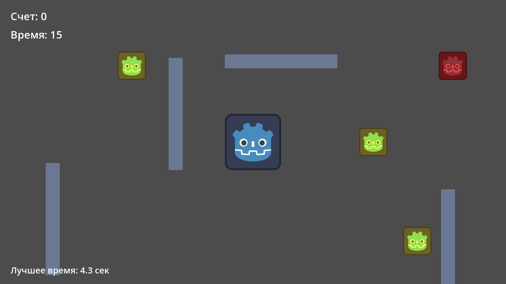
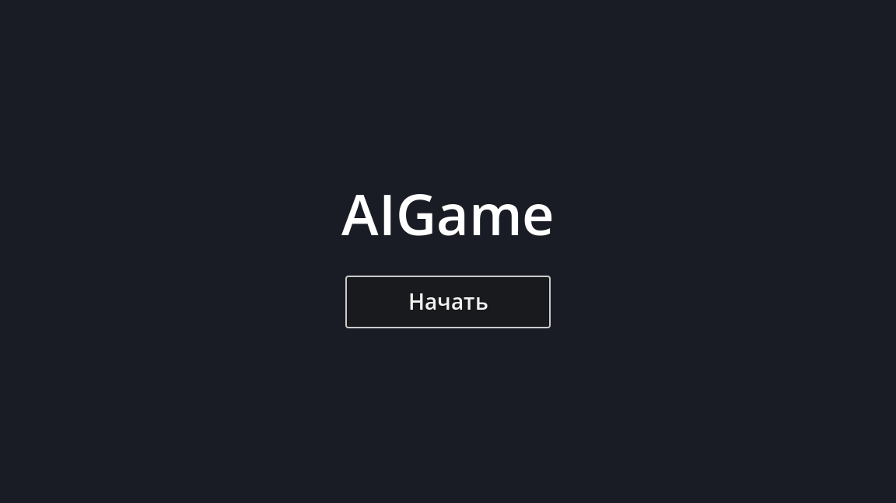
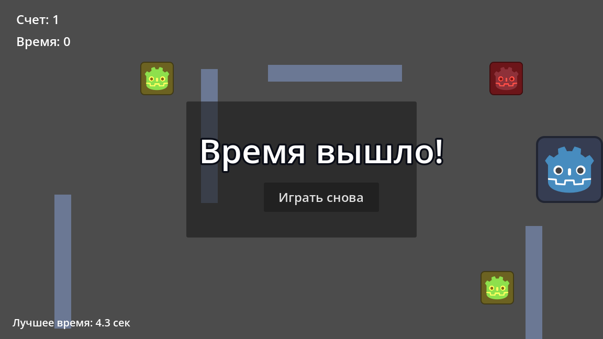

# AIGame

[](https://github.com/JERCYQUE/ai-game/releases/latest)


**2D-игра, полностью созданная ИИ-агентом** — от первой сцены до релизной сборки.
Короткая аркада: соберите три монеты за 15 секунд, не попавшись патрулирующему врагу.



## О проекте

Это мини-игра на **Godot 4.7**, которую целиком написала ИИ-модель: она создавала сцены и узлы, писала GDScript, генерировала звуки, запускала игру и проверяла её поведение, а затем собрала и опубликовала релиз. Человек задавал задачу и проверял результат — код, разметка сцен и ассеты созданы агентом.

Партия длится 15 секунд. На карте три монеты, один враг и четыре стены-препятствия. Соберите все монеты — победа; истечёт время или враг коснётся игрока — поражение. Лучшее время прохождения сохраняется между запусками в `user://highscore.cfg`.

## Скриншоты

| Главное меню | Финал партии |
|:---:|:---:|
|  |  |

## Управление

| Действие | Клавиши |
|:--|:--|
| Движение | **W A S D** или **стрелки** |
| Рестарт | **R** |

Рестарт также доступен кнопкой **«Играть снова»** на панели результата. Отсчёт времени стартует с первого движения игрока — до этого таймер стоит и показывает полные 15 секунд, так что осмотреться перед началом можно спокойно.

## Правила

- **Цель** — собрать все `3` монеты. На каждый сбор играется звук, монетка лопается и рассыпается искрами.
- **Враг** патрулирует влево-вправо по синусоиде. Его касание заканчивает партию сообщением «Вас поймали!».
- **Таймер** на 15 секунд запускается первым движением. Ноль на счётчике — «Время вышло!».
- **Рекорд** — лучшее время победы; оно сохраняется в файл и показывается в левом нижнем углу.
- Диагональное движение нормализовано: по диагонали игрок не быстрее, чем по прямой.

## Скачать

Готовая сборка — в разделе [**Releases**](https://github.com/JERCYQUE/ai-game/releases/latest):

**[⬇ AIGame.exe (104 МБ)](https://github.com/JERCYQUE/ai-game/releases/latest/download/AIGame.exe)**

Windows 10/11, x64. Установка не требуется: скачайте файл и запустите. Бинарник собран под Direct3D 12 (`Forward+`).

## Запуск из исходников

1. Установите [Godot 4.7](https://godotengine.org/download) или новее.
2. `git clone https://github.com/JERCYQUE/ai-game.git`
3. Откройте папку проекта в Godot (`project.godot`) и нажмите **F5**.

Сборка релиза — скриптом `tools/export_release.ps1` (нужны шаблоны экспорта Godot для Windows). Результат кладётся в `build/`, которая не попадает в git.

## Автоматическая сборка

Релизы собирает GitHub Actions (`.github/workflows/release.yml`). При пуше тега вида `v*` раннер скачивает Godot 4.7.2 и шаблоны экспорта для Windows, импортирует проект, собирает `.exe` и публикует его в Releases с автоматически сгенерированным описанием.

И CI, и локальный скрипт перед экспортом убирают из `project.godot` автозагрузку `MCPRuntimeProbe`: её скрипт лежит в `addons/godot_mcp`, который исключён из сборки, и без этой правки собранная игра падала бы на старте.

Чтобы выпустить новую версию:

```bash
git tag v1.0.2 && git push origin v1.0.2
```

## Структура проекта

```
ai-game/
├── project.godot            # настройки проекта, ввод, автозагрузки
├── main_menu.tscn/.gd       # главное меню, переход в игру
├── main.tscn/.gd            # игровая сцена: HUD, счёт, таймер, победа/поражение
├── player.tscn/.gd          # игрок: движение с ограничением по границам экрана
├── coin.tscn/.gd            # монетка: сбор, эффект «лопанья», облако искр
├── enemy.tscn/.gd           # враг: синусоидальный патруль, ловля игрока
├── wall.tscn                # стена-препятствие
├── spark_particles.tscn/.gd # частицы искр
├── sounds/                  # 4 звука: монета, победа, поражение, поимка
├── docs/screenshots/        # скриншоты для этого README
├── tools/export_release.ps1 # локальная релизная сборка
├── .github/workflows/release.yml # CI: сборка exe и публикация релиза
└── addons/godot_mcp/        # MCP-мост «редактор Godot ↔ ИИ-агент» (MIT)
```

## Как это сделано

Игра собрана связкой **DeepSeek Harness** + **Godot MCP**:

- **DeepSeek Harness** — среда, в которой работает агент: он держит контекст задачи, читает и пишет файлы проекта, запускает команды.
- **Godot MCP** (`addons/godot_mcp`) — мост между агентом и редактором Godot. Через него агент в реальном времени создавал узлы и сцены, привязывал скрипты, настраивал Input Map, запускал игру (`play_scene`), подавал синтетический ввод, читал значения свойств живых узлов (`score`, `time_left`) и снимал скриншоты прямо из работающего процесса.
- **Тестирование** — вместо «на глаз» агент проверял поведение в запущенной игре: собирал монеты, ждал истечения таймера и убеждался, что счёт и панель результата меняются как задумано. Скриншоты в этом README сняты именно так.

## Технологии

| | |
|:--|:--|
| Движок | Godot 4.7.2 (GDScript, Forward+) |
| Рендер | Direct3D 12 |
| Аудио | WAV через `AudioStreamPlayer` |
| Платформа | Windows 10/11 x64 |
| Разработка | DeepSeek Harness + Godot MCP |
